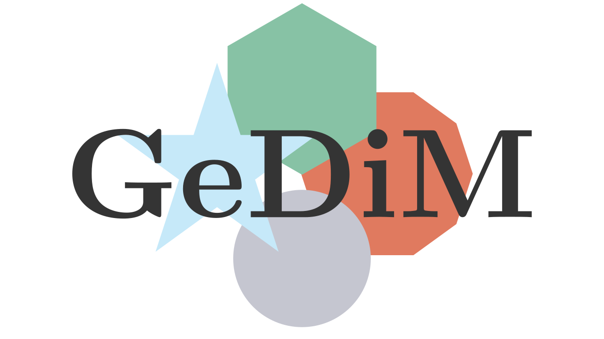

# 

**`GeDiM`** (GEometry for DIscretization MEthod library) is an open-source C++ library based on collaborative development. 
It provides a flexible framework for the common geometrical operations in 1D, 2D, and 3D used in discretization methods for solving linear and nonlinear partial differential equations. 

**`GeDiM`** is inspired by and built upon the foundational research of the Numerical Analysis Group in the Department of Mathematical Sciences "Giuseppe Luigi Lagrange" (DISMA) at the Politecnico di Torino.

This file can be used by citing references in CITATION.cff file.

For further information see the official website [polydim](https://www.polydim.it/).

**GeDiM-core** is the core of the library of **gedim** and requires only the main external libraries
- [Eigen](https://eigen.tuxfamily.org/index.php?title=Main_Page) 
- [BLAS](https://www.netlib.org/blas/)  	            
- [LAPACK](https://www.netlib.org/lapack/)    

to be installed.

>[!TIP]
>For complete functionality, including examples, tests, and full documentation, please install and refer to the main [**PolyDiM**](https://github.com/AURION-Polito/PolyDiM) library.

